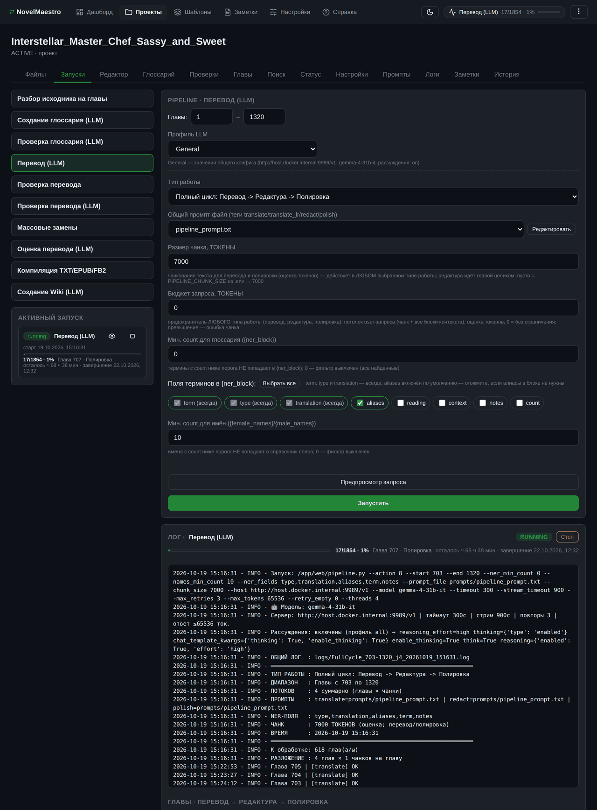
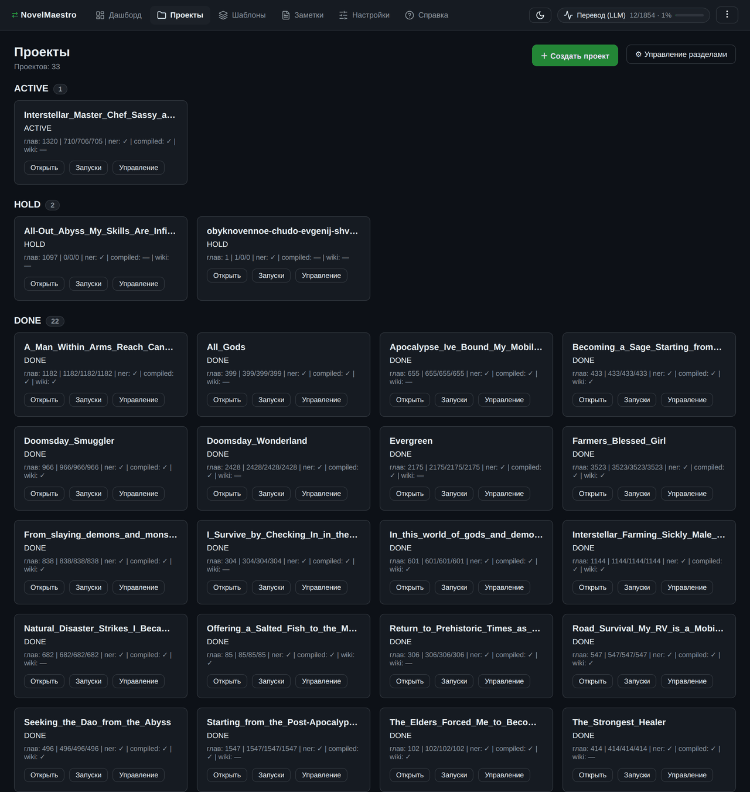
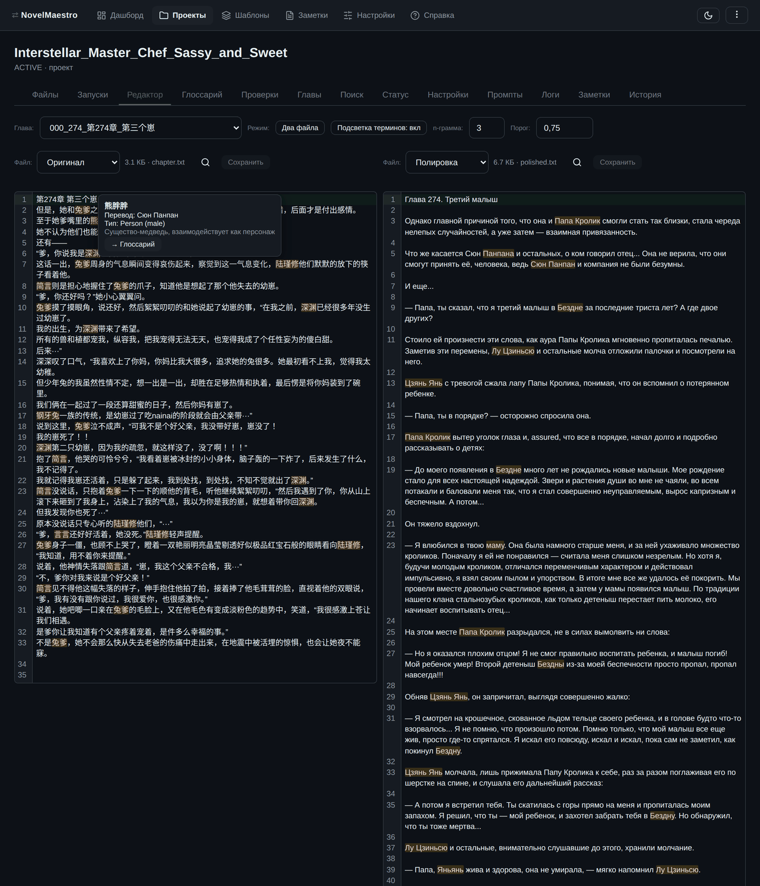
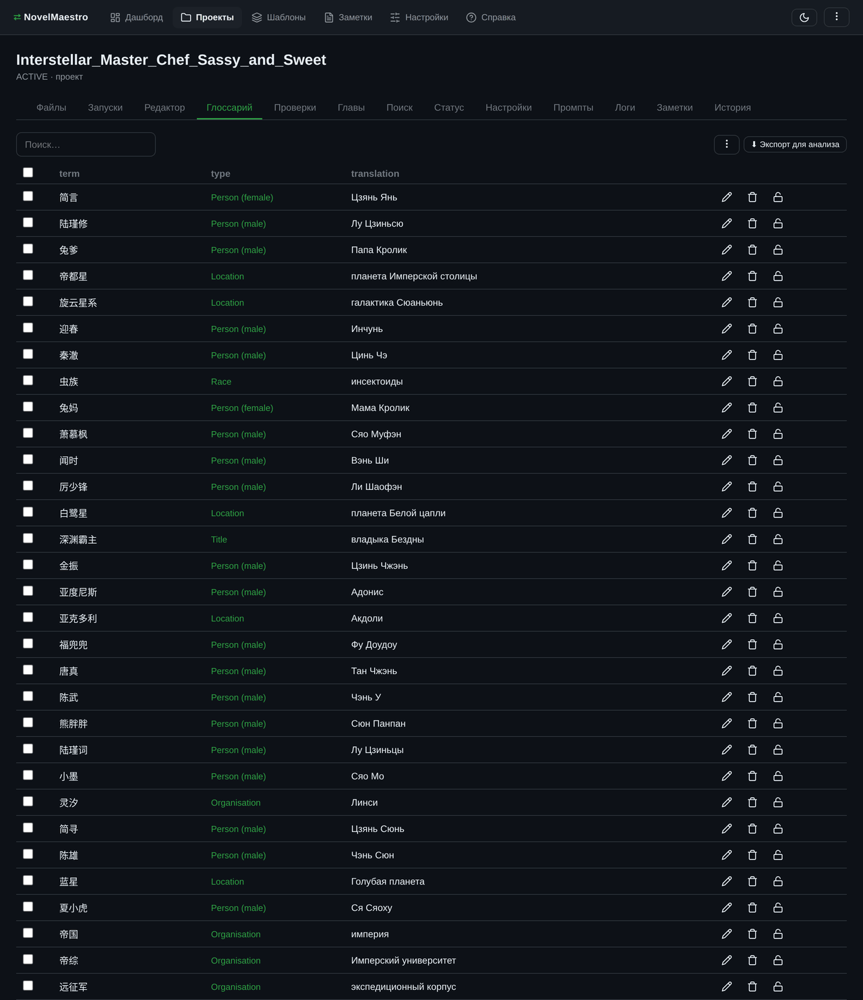
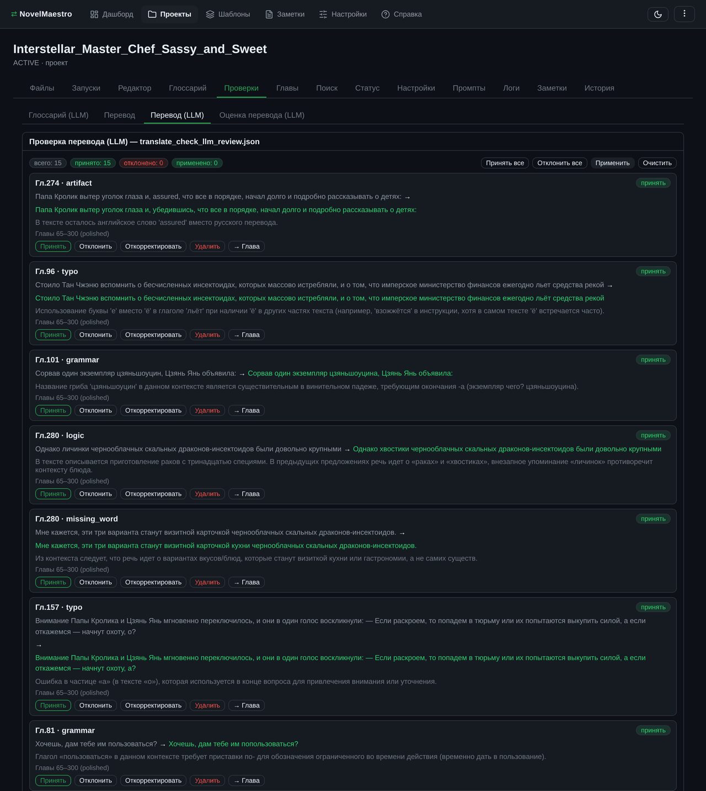
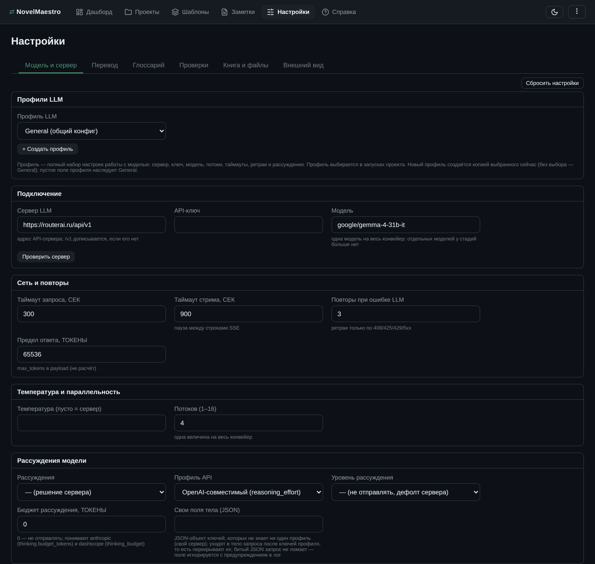

# 📖 NovelMaestro

**Перевод веб-новелл с любого языка на русский с помощью LLM** — китайский, английский, корейский, японский и другие: программа универсальна, исходный язык задаётся промптами и глоссарием. Она автоматизирует рутину (разбор исходника, глоссарий имён, перевод, проверки, сборку EPUB), а ключевые решения — выбор промптов, проверка качества, финальная корректура — остаются за вами.

> Интерфейс — веб-страница в браузере: сервер поднимается одной
> командой, всё управление — мышкой. Никакого программирования.

---

## Интерфейс

Всё управление — в браузере: сверху разделы программы, внутри проекта — свои вкладки. Скриншоты сняты с рабочей книги.


*Центр управления конвейером: карточки всех стадий, форма выбранной — профиль LLM, размер чанка и бюджет запроса в токенах — и живой лог с прогрессом по главам.*

<table>
  <tr>
    <td width="50%"></td>
    <td width="50%"></td>
  </tr>
  <tr>
    <td><em>Проекты: разделы ACTIVE / HOLD / DONE, карточки с числом глав и готовностью по стадиям</em></td>
    <td><em>Редактор: оригинал и готовый текст рядом, подсветка терминов глоссария с подсказкой</em></td>
  </tr>
  <tr>
    <td></td>
    <td></td>
  </tr>
  <tr>
    <td><em>Глоссарий: таблица терминов — тип, перевод, фильтры, кнопка замка в строке</em></td>
    <td><em>Проверки: правки LLM по главам, решения «принять / отклонить» и применение разом</em></td>
  </tr>
</table>


*Настройки: конфиг пятью субвкладками реестра, карточки блоков с подсказками к полям и профили LLM — сохранение без кнопки «Сохранить».*

Сверху — панель навигации:

- **Дашборд** — сводка по всем проектам и последние запуски;
- **Проекты** — разделы ACTIVE/HOLD/DONE, карточки, управление;
- **Настройки** — единственный редактор конфига: весь `.env` (LLM-подключение и настройки своего сервера, модель, дефолты стадий) пятью субвкладками реестра плюс локальная «Внешний вид»; кнопки «Сохранить» нет — изменённое поле сохраняется само, а на каждой субвкладке реестра есть своя кнопка «Сбросить настройки» (поля вкладки вернутся к значениям по умолчанию из реестра); здесь же карточка «Профили LLM» (свои наборы настроек модели); «Внешний вид» (тема и кегль редакторов) — про localStorage браузера, а не про конфиг, и кнопки сброса у неё нет;
- **Шаблоны** — наборы промптов и файлов для новых проектов;
- **Заметки** — общие заметки (markdown);
- **Справка** — подробные инструкции по всем разделам программы (включая руководство по регулярным выражениям).

Внутри проекта — вкладки: **Файлы, Запуски, Редактор, Глоссарий, Проверки, Главы, Поиск, Статус, Настройки, Промпты, Логи, Заметки, История**. «История» — контрольные точки проекта: снимки файлов книги в хранилище внутри проекта, сравнение двух точек и возврат к любой из них.

---

## Возможности

- **Разбор исходника** — EPUB/TXT автоматически превращается в папки глав;
- **Глоссарий имён и терминов** (LLM) — извлечение, проверка, правки с подтверждением человеком;
- **Перевод → редактура → полировка** (LLM) — три прохода над каждой главой с единым промптом и контекстом;
- **Проверки** — алгоритмическая сверка оригинала и перевода, а также LLM-поиск ошибок с review-флоу «принять/отклонить/применить»;
- **Компиляция** — готовые TXT, EPUB и FB2 с обложкой, метаданными и страницей поддержки;
- **Wiki** — LLM-компендиум по глоссарию и тексту (в т.ч. в форматах для публикации на Rulate);
- **Массовые замены** — регулярные выражения по всем главам без LLM; предпросмотр показывает эффект каждого правила с видимыми пробелами и переносами;
- **Шаблоны проектов** — промпты и файлы для разных типов книг.

## Как это устроено

```text
EPUB/TXT → главы → глоссарий → перевод → редактура → полировка
→ проверки → TXT/EPUB/FB2 + Wiki
```

Каждая стадия — карточка с формой на вкладке «Запуски» проекта. Между стадиями — человеческие контрольные точки: правки глоссария и перевода принимает человек, а не машина.

---

## Быстрый старт

### Windows 10/11 — портативная сборка (основной способ)

Установка не нужна. Скачайте со страницы [Releases](https://github.com/LynxPDA/NovelMaestro/releases) архив `novelmaestro-portable-<версия>.zip`, распакуйте его в любую папку и запустите **`start.bat`** — программа откроет браузер с интерфейсом. Python ставить не нужно, он уже внутри сборки. При первом запуске программа сама создаст папку `projects/` (разделы **ACTIVE / HOLD / DONE**) и `.env` из шаблона.

### Linux/macOS (и Windows с Python) — venv

```bash
# 1. Создать venv, поставить зависимости и показать активный стек
./dev.sh setup

# 2. Запустить web-интерфейс (в том же venv)
./dev.sh run
```

`dev.sh` — обёртка над venv для разработки (`setup` / `run` / `test` / `deps` / `shell` / `clean`): внутри него команды остаются обычными `python3 …`. вручную тот же путь — обычная схема venv:

```bash
python3 -m venv .venv && source .venv/bin/activate   # Linux/macOS
pip install -r requirements.txt && python3 run.py
```

(на Windows вместо `python3` — `python run.py` или `py run.py`; venv: `py -m venv .venv && .venv\Scripts\activate`)

Допустимая альтернатива без venv — системный Python (Debian/Ubuntu):

```bash
sudo apt install python3-httpx python3-dotenv python3-dulwich python3-tqdm python3-ahocorasick python3-pytest python3-pytest-xdist
```

После запуска откроется браузер с интерфейсом.

### Docker (сервер, без установки Python)

```bash
docker compose up -d --build
# → http://localhost:8756  (в браузере)
```

Данные живут в папках `projects/` и `templates/` (монтируются в контейнер). Конфиг — общий `.env` в томе `projects/`: при первом запуске он создаётся из шаблона, а дальше его правит вкладка «Настройки» — правки переживают обновление образа (свой локальный сервер на той же машине виден контейнеру как `host.docker.internal`, см. комментарии в `docker-compose.yml`). Подробности — порты, переменные, обновление — в [packaging/README.md](packaging/README.md).

Параметры сервера: `python3 run.py --no-open` (без браузера), `--projects-dir <путь>` (своя папка проектов), а также `--host/--port/--auth/--token` и `--no-restart`/`--no-update-check` (после обновления сервер перезапускает себя сам, здесь это выключается) — см. `python3 web/main.py --help`; подробности настройки сервера — [DEVELOPERS.md](DEVELOPERS.md).

## Первые шаги

### 1. Создайте проект

Вкладка **«Проекты»** → «＋ Создать проект». Мастер спросит:

1. раздел (по умолчанию ACTIVE);
2. имя проекта (латиницей — имя папки);
3. русское название, автор, жанры — опционально;
4. тип книги — набор промптов (по умолчанию `General`).

Опционально можно сразу загрузить обложку и исходник книги.

### 2. Загрузите исходник

Внутри проекта вкладка **«Файлы»** → «＋ Загрузить» (или перетащить файлы на список): загруженное попадает в текущую папку — зайдите в `source/` и положите `.epub` или `.txt` туда. Проще сразу указать исходник в мастере создания проекта — он окажется в `source/` сам.

### 3. Запустите конвейер

Вкладка **«Запуски»** проекта (вторая после «Файлов»; кнопка «Запуски» в карточке проекта ведёт туда же). Карточки идут по порядку:

1. **Разбор исходника на главы** — разбейте книгу на главы (режим «По TOC» для epub);
2. **Создание глоссария (LLM)** — извлеките имена и термины;
3. **Проверка глоссария (LLM)** — LLM предложит правки полей, а явные повторы и случайные слова пометит на удаление; решения принимаете вы во вкладке «Проверки»;
4. **Перевод (LLM)** — полный цикл: перевод → редактура → полировка; для малоресурсных языков — **«Перевод с расширенным контекстом»** (словарь/правила/примеры из `source/` + бюджеты запроса);
5. **Проверка перевода** и **Проверка перевода (LLM)** — найдите ошибки, примените правки;
6. **Компиляция TXT/EPUB/FB2** — соберите готовый файл;
7. **Создание Wiki (LLM)** — по желанию.

Форма каждой стадии одна: все поля идут из реестра настроек, значения подставляются из общего `.env` (или встроенных дефолтов), поэтому достаточно нажать «Запустить». Изменённые поля помечает кнопка «Сбросить настройки (N)» в шапке панели — она возвращает форму к значениям конфига.

У всех редакторов текста есть поиск и замена — кнопка с лупой в заголовке панели, она же `Ctrl+F` / `Ctrl+H` в редакторе CodeMirror.

Во время запуска — живой лог и прогресс; кнопка **«Стоп»** останавливает работу. История запусков — на «Дашборде» («Последние запуски») и во вкладке «Логи».

### 4. Правьте тексты

- **Редактор** — главы проекта: оригинал и выбранный артефакт рядом (перевод, редактура или полировка — панель выбирается своим списком), подсветка терминов глоссария;
- **Глоссарий** — таблица `ner.json`: правка строк, поиск, фильтры по типам и столбцам, экспорт; замок на термине защищает его от правок и от прогона проверки;
- **Поиск** — одна строка текста по файлам книги: группы файлов (артефакты глав по именам стадий, заметки, промпты, отчёты, логи), фрагменты с подсветкой, постранично; клик по имени файла открывает его в редакторе тут же, на вкладке «Поиск», с уже открытым поиском («← Назад» ведёт обратно к результатам);
- **Проверки** — карточки правок LLM: принять/отклонить/применить;
- **Главы** — названия глав проекта (по типам файлов) и их правка; **Статус** — готовность по типам глав (перевод, редактура, полировка) с отсутствующими главами; **История** — контрольные точки файлов проекта;
- **Промпты** — файлы промптов с редактором и предпросмотром.

## Настройка LLM-сервера

Программа работает с любым [OI]-совместимым сервером — локальным или облачным:

- **Локальный** (рекомендуется, бесплатно и приватно): [llama.cpp](https://github.com/ggml-org/llama.cpp); также подходят vLLM, Ollama, LM Studio;
- **Облачный**: [RouterAI](https://routerai.ru) — единый [OI]-совместимый API (`https://routerai.ru/api/v1`) к 100+ моделям с оплатой в рублях.

Подключение задаётся в общем `.env` (шаблон — `templates/.env.example`; проще всего — страница «Настройки», она сохраняет те же ключи; в Docker это `projects/.env` в постоянном томе):

```ini
HOST=https://routerai.ru/api/v1     # или адрес локального сервера, напр. http://localhost:8080/v1
API_KEY=your-api-key                # локальный сервер может работать без ключа
MODEL=google/gemma-4-31b-it         # рекомендуемая модель (сент. 2026) — см. ниже
```

**Рекомендуемая модель для перевода** (на сентябрь 2026 года) — `google/gemma-4-31b-it` в режиме рассуждений **high**: в блоке «Рассуждения модели» на странице «Настройки» задайте уровень `high` (локально через llama.cpp — GGUF-сборка Gemma 4 31B IT, режим размышления включается чат-шаблоном модели).

Сервер, ключ и модель — **одни на весь конвейер**: отдельного сервера у стадии нет (стадийных `<СТАДИЯ>_HOST`/`_MODEL`/`_API_KEY` в конфиге тоже нет — они ни на что не влияли). Нужного набора настроек несколько — для этого профили (ниже). Без `.env` программа не падает: работает на встроенных дефолтах реестра и ручном вводе.

**Конфиг один** — общий `.env`: он редактируется на странице «Настройки» (пять субвкладок реестра плюс локальная «Внешний вид», карточки блоков, поля с подсказками) и задаёт значения для всех книг. Своего `.env` у книги больше нет: поля запусков, изменённые для одной книги, — рабочее состояние браузера, а не второй конфигурационный файл. Приоритет: CLI-флаг > переменные окружения процесса > выбранный профиль > общий `.env` > встроенный дефолт реестра.

### Профили LLM (несколько наборов настроек)

**Профиль** — полный набор настроек работы с моделью: сервер, ключ, модель, таймауты, повторы, потоки, температура и весь блок рассуждений. Профили нужны, когда серверов несколько — «домашний» llama.cpp и «облачной» RouterAI, модель для черновика и модель для чистовой правки — и между ними хочется переключаться одним выбором, а не переписывать `.env`.

- **General** — профиль по умолчанию: его значения и есть общий `.env`, ничего не дублируется (без выбора профиля всё работает ровно как раньше); его нельзя переименовать и удалить.
- Свои профили создаются на странице «Настройки» → субвкладка «Модель и сервер» → карточка «Профили LLM»: один выпадающий список профилей и кнопки «+ Создать профиль», «Переименовать», «Удалить»; имя задаётся той же модалкой, что файлам и разделам (поле с текущим именем, Enter подтверждает), удаление — окно со словом «УДАЛИТЬ». **Пустое поле профиля наследует General** — заполнять нужно только отличия, а новый профиль создаётся копией выбранного (его переопределения плюс унаследованные значения General). Секреты везде под маской: точка на каждый символ значения — маска не значение, сохранённый ключ остаётся.
- Значения профилей лежат в файле `llm_profiles.json` рядом с общим `.env` (в Docker — в том же постоянном томе). Он не конфигурация в смысле `.env`, а данные: пользовательские имена, которых в реестре не может быть.
- Профиль выбирается **у каждой стадии** — это первое поле её формы (сразу под диапазоном глав), с подписью «что выбрано»: «Дачный — наследует General (http://192.1.8.8:9989, дом-модель, рассуждения: on)». У стадий одного проекта выбор свой: перевод можно гнать облачной моделью, глоссарий править домашней. Выбор помнится браузеру по проекту и стадии; остальных полей LLM в форме нет по-прежнему.

> ℹ️ Синтаксис `.env` обычный: `#` после значения — комментарий (значение с решёткой пишется в кавычках), `export ` не обязателен, `${VAR}` внутри значения не раскрывается.
>
> 🔒 Файлы `.env` содержат ключи и не коммитятся в git.

## Документация

- **Справка** в приложении (раздел в панели навигации) — инструкции по проектам, стадиям и регулярным выражениям;
- [DEVELOPERS.md](DEVELOPERS.md) — техническая документация для разработчиков (архитектура, конвейер, конфигурация, тесты);
- [web/README.md](web/README.md) — контракт web-слоя и API;
- [tools/README.md](tools/README.md) — вспомогательные утилиты вне конвейера: юзерскрипты (Lite, Rulate), их сборка и манифест локальных библиотек SPA;
- [AGENTS.md](AGENTS.md) — правила для AI-агентов.

## Зависимости

| Пакет (pip / apt) | Назначение | Обязательность |
| --- | --- | --- |
| `httpx` / `python3-httpx` | HTTP-транспорт LLM: один клиент на процесс, пул соединений, раздельные connect/write/read таймауты | обязательный |
| `python-dotenv` / `python3-dotenv` | разбор `.env`: `#` — комментарий, `${}` не раскрывается | обязательный |
| `dulwich` / `python3-dulwich` | локальная история проектов (контрольные точки на git, без git-бинарника) | обязательный |
| `tqdm` / `python3-tqdm` | прогресс-бары CLI | опциональный (без него прогресс — только строками лога) |
| `pyahocorasick` / `python3-ahocorasick` | быстрый поиск терминов | опциональный (есть regex-fallback) |
| `pytest` / `python3-pytest` | тесты: раннер один — pytest | только для разработки |
| `pytest-xdist` / `python3-pytest-xdist` | параллельный прогон (`-n auto`, он же дефолт `./dev.sh test`) | только для разработки |
