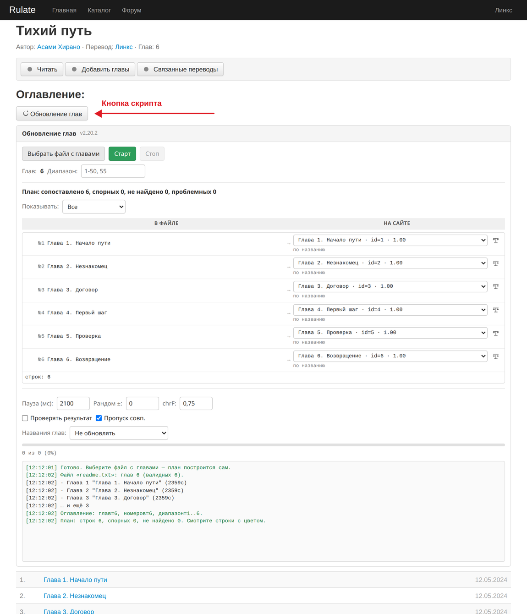

# rulate_reload — userscript Rulate

Юзерскрипт для браузера (Tampermonkey/Violentmonkey): массовое обновление переводов глав на **tl.rulate.ru** (и `rulate.ru`) из локального `.txt` — заливает текст главы и/или меняет название, с паузами и проверкой.



Кнопка **«Обновление глав»** появляется под заголовком «Оглавление:» — в том же оформлении, что кнопки сайта. По нажатию раскрывается панель: выбор файла, план «глава файла → глава сайта» и запуск.

## Установка

1. Установите расширение **Tampermonkey** (Chrome/Firefox/Edge).
2. Поставьте скрипт по ссылке — менеджер покажет окно установки и будет обновлять скрипт сам:
   `https://raw.githubusercontent.com/LynxPDA/NovelMaestro/main/tools/rulate_reload/rulate-bulk-update.user.js`
3. Или вручную: панель расширения → «Создать новый скрипт» → вставить содержимое `tools/rulate_reload/rulate-bulk-update.user.js` целиком → сохранить (Ctrl+S).
4. Откройте книгу на Rulate: `https://tl.rulate.ru/book/<id>` — под заголовком «Оглавление:» появится кнопка **«Обновление глав»**.

Кнопка есть **только на книгах, где у вас есть права**: на своей книге или там, где сайт показывает кнопки правки. На чужой книге, которую вы просто читаете, не появляется ни кнопки, ни панели.

Скрипт работает **от имени вашей учётки** (куки сайта), поэтому перед использованием залогиньтесь на Rulate в том же браузере.

## Использование

1. Подготовьте `.txt`: каждая глава — заголовок `# [Название :|: Номер]`, ниже — текст главы (см. «Формат файла»).
2. Нажмите «Обновление глав» и выберите файл: скрипт разберёт главы и покажет, какие не годятся для заливки.
3. Скрипт сам прочитает оглавление книги и построит таблицу «глава файла → глава сайта» — что куда пойдёт.
4. Просмотрите таблицу: спорные и не найденные строки подсвечены, нужную главу выбирают из списка. Фильтр «Только спорные» оставляет строки, которые скрипт не решил сам.
5. Настройте по вкусу: пауза между главами, проверка результата, пропуск совпадающих, режим названий, диапазон глав.
6. «Старт» — заливка ровно по плану; «Стоп» — остановка между главами.
7. Под полосой прогресса видно, сколько сделано, сколько осталось и с каким темпом: `3 из 8 (38%) · осталось 2 с · 405 мс/глава`.

Если что-то не залилось, в конце прогона будет перечень — глава и причина:

```text
Ошибки по главам (2):
   · №2 «Глава 2. Имя» — не похожа на главу сайта (chrF 0.083)
   · №3 «Глава 3. Имя» — чтение страницы главы: нет доступа (403) — сессия истекла? войдите заново
```

## Формат файла

```text
# [Глава 12 :|: 12]
Текст главы…
вторая строка…

# [Глава 13 :|: 13]
…
```

- Заголовок: `# [` + название + ` :|: ` + номер + `]`.
- Номер берётся из названия вида `Глава 12`. Тег после `:|:` нужен, только когда номера в названии нет вовсе: `# [Пролог. Начало :|: 7]` — такой же тег пишет сборка книги в NovelMaestro.
- `Глава 12.5` и `Глава 12–14` считаются проблемными и пропускаются: одному номеру сайта они не соответствуют.
- Текст главы идёт до следующего заголовка; пустые строки схлопываются.

## План и правка сопоставления

Таблица показывает, что скрипт собирается делать, и даёт это поправить. Заливка идёт строго по таблице: ваши правки не пересчитываются.

- **План строится сам**, как только выбран файл. Отдельной кнопки «План» нет.
- Спорные строки подсвечены. В списке глава выглядит как «название · id», «— не выбрана —» значит «эту строку не лить». Чтобы снять строку, выберите «— не выбрана —».
- **Кандидаты идут по похожести названия**: сверху то, что ближе к названию главы файла. Счёт — подсказка, а не решение: автоматический выбор запрещён, потому что ошибка означает запись перевода в чужую главу. Дальше идут соседние по оглавлению главы, затем вся книга.
- **Кнопка-весы** справа от списка — сверка одной главы: читает её страницу на сайте и сравнивает сохранённый перевод с вашим файлом. Итог печатается под списком: «Похожа · 1.00» или «Не похожа · 0.42». Ничего на сайт не записывает.
- **Все строки видны сразу**, без прокрутки до конца списка.

Если главы с таким номером нет, она ищется по названию. Нестандартные главы сайта не трогаются и попадают в отчёт.

## Сверка главы (chrF)

Перед записью глава сверяется с **уже сохранённым переводом** на сайте — тем, что там сейчас. Похожесть меряется числом от 0 до 1 (chrF): 1 — тексты совпадают, 0 — общего нет.

- та же глава (мелкая правка, повторный перевод части предложений) — **0.83–0.99**;
- две разные главы одной книги — **0.48–0.54**.

Порог задаётся полем **chrF** (по умолчанию `0.75`), рядом с паузой. **`0` или пустое поле выключают сверку** — например, для намеренной полной замены текста.

Не прошло порог — запись не выполняется, в лог идёт `ОТКАЗ: глава на сайте не похожа на нашу … нумерация разъехалась?`. Это последний заслон: срабатывает, даже когда номер и название совпали, а на сайте на самом деле другая глава.

**Сверка не заменяет проверку файла.** Она ловит «не ту главу», а не «недособранный файл»: обрезанный вдвое текст даёт высокий счёт и проходит порог. Перед заливкой убедитесь, что в файле все главы.

## Настройки

| Поле панели | По умолчанию | Назначение |
| --- | --- | --- |
| Пауза (мс) | `2100` | задержка между главами (защита от бана) |
| Рандом ± | `0` | разброс паузы ±N мс (мин. 100) |
| Проверять результат | выкл. | перечитать главу после записи и сверить — второй проход на каждую главу |
| Пропуск совп. | вкл. | не лить главы, чьи текст и название уже совпадают |
| chrF | `0.75` | порог сверки; `0` или пусто — выключено |
| Названия глав | выкл. | `off` / `title-only` (только названия) / `title-and-body` |
| Диапазон | пусто | `1-50, 55` — заливать только эти номера |

Поиск по названию отдельной настройки не имеет: он работает всегда, а его результат виден в плане.

## Диапазон глав

Поле «Диапазон» режет работу ещё до похода на сайт: `1-50, 55, 60-70` — номера и интервалы, пусто — вся книга.

- Разделитель интервала — любое тире: `-`, `–`, `—`, `−`.
- Непонятный кусок (`abc`) не выбрасывается молча: он назван в подсказке у поля и в логе, а распознанное работает.
- Строка вне диапазона в таблице бледнеет и подписана «вне диапазона», в «спорные» не попадает и в счётчики плана не входит.
- Главу без номера (пролог, интерлюдия без числа) диапазон не режет: судить не по чему.

## Ограничение: главы, разбитые на фрагменты

Глава на Rulate бывает как одним блоком, так и несколькими фрагментами. Такая глава **не обновляется** — скрипт пропускает её и пишет причину в лог (`фрагментов 29 (>1): обновление не выполняется`).

Причина в том, что фрагмент — это не абзац, а произвольный кусок: у старого перевода своя разбивка, у нового текста другая, и угаданная граница увела бы половину текста в чужой фрагмент. К тому же фрагменты листаются по страницам, и скрипт видит только текущую.

Такие главы правят вручную на сайте: там видно всё разбиение целиком.

## Безопасность

- Скрипт пишет на сайт только ваши переводы и обновляет названия через штатные формы редактирования сайта.
- Сначала можно нажать **кнопку-весы** у нужной строки — она покажет счёт, ничего не записывая.
- Паузы и рандом — базовая защита от антиспама; для больших книг увеличьте `Пауза (мс)`.
- Пока идёт запись, в шапке панели висит предупреждение «Идёт запись — не закрывайте окно и браузер».

## Документация

- [DEVELOPERS.md](DEVELOPERS.md) — техническая документация: сборка из `src/`, сопоставление с сайтом, метрика сверки, время на главу.
- [tools/README.md](../README.md) — обзор утилит вне конвейера и сборка юзерскриптов.
